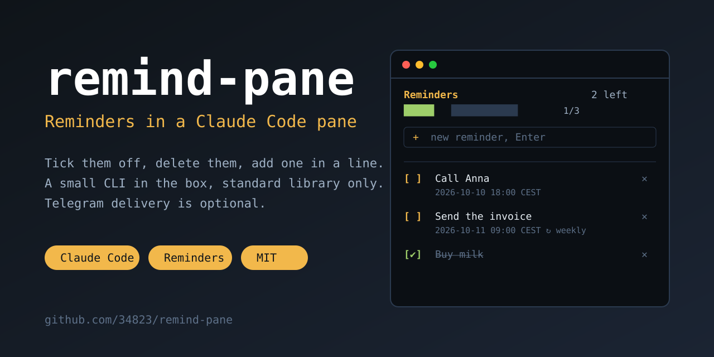

<p align="center">
  
</p>

<p align="center">
  <a href="https://github.com/34823/remind-pane/stargazers"></a>
  <a href="LICENSE"></a>
  <a href="https://github.com/34823/remind-pane/commits/main"></a>
  
  
  
</p>

# remind-pane — Reminders in a Claude Code pane

> Keep your reminders beside the conversation: tick them off, delete them, add a new one in a line.
> Ask Claude to set one in plain words. A small CLI in the box, no dependencies; delivery to Telegram is optional.

**Quick start** (details in [Install](#install)):

```
/plugin install remind-pane --marketplace 34823/remind-pane
```

Then `/remind-pane`, type a reminder in the field, Enter — done.

## Features

- **A pane on the right** — your reminders, dated ones first by time, the rest after them. Click a row to tick it
  off or untick it (done items are struck through), **✕** deletes it for good, the field at the bottom adds a
  reminder without a date. A progress bar shows how many are done. The pane refreshes every 30 seconds and after
  every turn, and reopens after `/clear`.
- **Ask Claude** — the `/remind` skill sets, shows, ticks off, moves and deletes reminders from the conversation:
  «remind me on Friday at 10:00 to call Anna», «every Monday remind me to send the report».
- **Dates and repeats** — `+30m` / `+2h` / `+1d`, or `YYYY-MM-DD HH:MM` in your time zone; `--repeat daily|weekly`;
  `shift` moves a reminder.
- **Done items vanish the next day** — marked done today, shown struck through until the end of the day, then removed.
- **Optional delivery to Telegram** — with a bot token and a chat id, `remind.py tick` (run it from a timer) sends
  overdue reminders and retries on errors. Without them nothing is sent: reminders are stored and shown in the pane.

```
 Reminders                                   2 left
 █████░░░░░░░░░░░  1/3
 + new reminder, Enter
 ──────────────────────────────────────────────
 [ ] Call Anna                                 ✕
     2026-10-10 18:00 CEST
 [ ] Send the invoice                          ✕
     2026-10-11 09:00 CEST ↻ weekly
 [✔] Buy milk                                  ✕
```

## How it works

State is one JSON file, `reminders.json`, in the data folder. Everything — the pane, the skill, your own scripts —
goes through the bundled CLI `backend/remind.py` (Python 3.9+, standard library only): changes are made under a file
lock, written atomically, with a `.bak` copy before every save. The pane never touches the file itself; it runs
`list --json`, `done`, `undone`, `del` and `add`.

The CLI also works on its own:

| Command | What it does |
|---|---|
| `add --text "…" [--when <time>] [--repeat daily\|weekly]` | add; without `--when` the reminder has no date |
| `list [--json]` | the list, with row numbers and ids |
| `done <n\|id>…` / `undone <n\|id>…` | tick off / untick |
| `del <n\|id>` | delete |
| `shift <n\|id> --by=+2h` | move a dated reminder (`--by=-30m` for earlier) |
| `now` | the current time in your time zone |
| `tick` | send overdue reminders to Telegram (needs the Telegram options) |
| `test` | send a test message to Telegram |

Run it as `python3 backend/remind.py <command>`. Options reach it as environment variables
(`REMIND_PANE_DATA`, `REMIND_PANE_TZ`, `REMIND_PANE_TELEGRAM_TOKEN`, `REMIND_PANE_TELEGRAM_CHAT`); the pane sets them from
the plugin options, for a run by hand set them yourself.

## Install

1. In Claude Code (a terminal session):

   ```
   /plugin install remind-pane --marketplace 34823/remind-pane
   ```

   Answer `y` to add the marketplace, pick a scope, set the options (all have defaults, the Telegram ones may stay empty).

2. `/remind-pane` opens the pane. Python 3.9+ must be on the PATH as `python3`, or put its path into the **Python**
   option (`/config`).

### Telegram delivery (optional)

1. Create a bot with [@BotFather](https://t.me/BotFather), put its token into the **Telegram bot token** option.
2. Write anything to your bot, then find your chat id (for example, open `https://api.telegram.org/bot<TOKEN>/getUpdates`
   and read `message.chat.id`) and put it into **Telegram chat id**.
3. Something has to call `tick` regularly — the plugin does not run in the background. A systemd timer example
   is in [docs/systemd.md](docs/systemd.md). Check it with `remind.py test`.

## Options (`/config`)

| Option | Default | |
|---|---|---|
| Python | `python3` | the Python that runs the CLI |
| Data folder | `~/.local/share/remind-pane` | `reminders.json`, its `.bak` copy and the lock |
| Time zone | system | IANA name (`Europe/Berlin`) for the dates you type and see |
| Telegram bot token | empty | optional; only for `tick` and `test` |
| Telegram chat id | empty | optional; the chat that receives reminders |

## Caveats

- Nothing delivers anything by itself: the pane and the skill only store and show. Without a timer calling
  `remind.py tick` (and the Telegram options) a due reminder just stays in the list.
- Reminders are stored as plain text in the data folder; the Telegram token is an option marked sensitive in
  Claude Code. Do not publish either.
- A failed send is retried on every `tick`; after 1440 failures the reminder is marked **NOT DELIVERED** but stays in
  the list. After a long downtime a repeating reminder is sent once, not for every missed turn; a late one carries a «late» note.
- `add` and `del` can wait up to 20 seconds while `tick` holds the lock during a send.
- Linux and macOS (uses `fcntl`); not Windows.

## Develop

```
claude plugin validate . --strict
claude plugin test .
python3 -m unittest discover tests
claude --plugin-dir .
```

## Feedback

If it is useful, a ⭐ on the repo helps others find it ([contributing](CONTRIBUTING.md), [security](SECURITY.md)). Ideas and questions — [Discussions](https://github.com/34823/remind-pane/discussions); bugs — [Issues](https://github.com/34823/remind-pane/issues) (a 👍 on an issue shows what matters most).

MIT license.

## Star history

[](https://star-history.com/#34823/remind-pane&Date)
